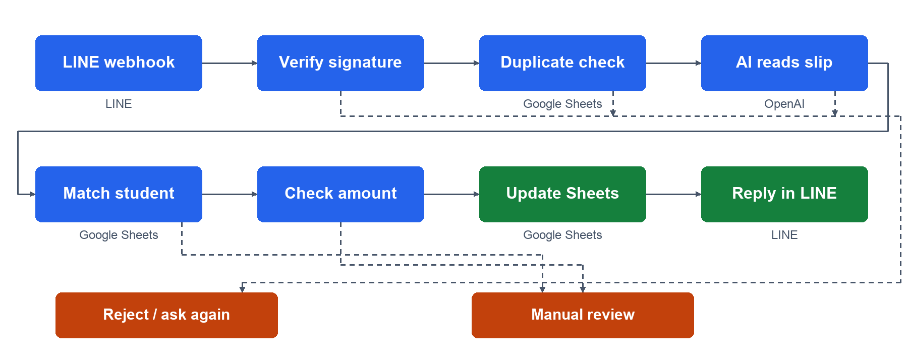
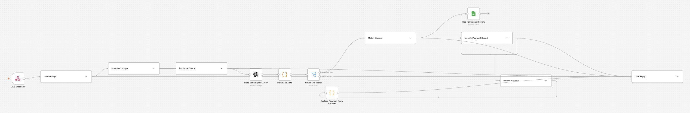

# Department Payment Collection Bot (LINE Slip Automation)

An n8n workflow that automates department fee tracking through LINE. It reads payment slips with AI vision, matches payer names to a student roster, checks the payment round and amount, records payments in Google Sheets, and replies in Thai.

I built this as the department **treasurer.** I used it to re-check past payment slips against the records I had verified by hand, to confirm the ledger was complete and accurate before calculating refunds of the remaining balance.

## Problem

Collecting department fees through bank transfer meant reading slips in chat, matching names to the roster, updating a spreadsheet, checking repeated submissions, and replying to each student. I connected these steps into one workflow, with a review queue for cases that need an organiser's decision.

## How It Works

| Step               | What happens                                                                                      | n8n nodes               |
| ------------------ | ------------------------------------------------------------------------------------------------- | ----------------------- |
| 1. Receive         | Compares the LINE request signature with a computed HMAC                                          | Webhook, Crypto, IF     |
| 2. Filter          | Keeps message events and asks for a slip if the message is not an image                           | Split Out, Filter, IF   |
| 3. Fingerprint     | Downloads the image and computes its hash                                                         | HTTP Request, Crypto    |
| 4. Duplicate check | Checks the image hash against transaction history                                                 | Google Sheets, Code, IF |
| 5. Read slip       | Extracts slip fields and checks the required values                                               | OpenAI, Code, Switch    |
| 6. Match student   | Accepts one exact name match or one first-name and surname-prefix match                           | Google Sheets, Code, IF |
| 7. Check round     | Uses the transfer date to select a round; checks the unpaid student row and amount due            | Code, Google Sheets, IF |
| 8. Record          | Updates the payment row and appends transaction history                                           | Google Sheets, Code     |
| 9. Review          | Queues unmatched students and failed round checks; asks for a new image when a slip is unreadable | Google Sheets, Code     |
| 10. Reply          | Sends a confirmation, retry request, or review message in Thai                                    | Code, HTTP Request      |

## Workflow Screenshots

[Complete workflow map — SVG](assets/workflow-complete.svg) · [PNG](assets/workflow-complete.png)

## Design Decisions

- **Extracts structured fields:** the AI prompt requests JSON and instructs the model to leave unreadable values blank; the parser checks required fields.
- **Matches one student:** a unique name match proceeds, while ambiguous matches go to manual review.
- **Checks duplicate images:** image hashes are compared with the transaction history before slip reading.
- **Checks request signatures:** the HMAC comparison runs before event processing.
- **Keeps an audit trail:** payment and review records include timestamps and LINE message identifiers.

## Tech Stack

n8n · LINE Messaging API · OpenAI vision model · Google Sheets · JavaScript

## Setup

1. Import [`workflow/payment-collection-bot.json`](workflow/payment-collection-bot.json) into n8n.
2. Connect LINE HTTP credentials, the LINE Channel Secret for Crypto, an OpenAI model credential, and Google Sheets OAuth2 credentials.
3. Create the tabs and columns in [`docs/sheet-structure.md`](docs/sheet-structure.md), then replace `YOUR_GOOGLE_SHEET_ID` in the Sheets nodes.
4. Check the raw-body signature calculation and configure the webhook in LINE Developers Console.
5. Follow the [validation checklist](docs/validation-checklist.md) with a separate test ledger before activation.

## Privacy Note

Student records and real payment slips are excluded. The workflow uses placeholder Sheet IDs and credential references. Slip images go to the configured AI service, and payment details are stored in Google Sheets; manage access and retention for your own environment.

## Limitations

- Reads data from the slip image only; it does not verify the transfer with the bank.
- Image-hash duplicate detection does not catch edited or re-exported slips.
- Used for retrospective verification of past slips by the treasurer; it has not been opened to students for live submissions.
